# ⚡️ `agent-fuse` (`afuse`) v0.6.0

**English** | **[简体中文](./README.zh-CN.md)** · **[Contributing](./CONTRIBUTING.md)** · **[Security](./SECURITY.md)**

**APFS Copy-on-Write Workspace Time Machine, Opt-In Agent Hooks & Runaway Circuit Breaker for AI Coding Agents.**



> Autonomous coding agents (`Claude Code`, `Cursor`, `Codex`, `Aider`) mutate uncommitted files and spawn subshells that run `rm -rf`. `git checkout` cannot recover untracked work. **`afuse` snapshots your dirty workspace via macOS APFS `clonefile(2)` (`0 Bytes` additional data blocks at `t=0`), reaps runaway agent process groups on sight, and restores whole trees or individual files in-place while preserving your active terminal's root `cwd` Inode.**

```text
$ afuse guard --max-delete 5 --auto-rollback -- sh -c 'rm -rf src/*'
⚡️ FUSE TRIPPED (deleted_entries >= max_delete=5)
   ├─ Process group frozen & reaped (SIGSTOP -> SIGKILL -pgid)
   ├─ Dirty workspace restored in 12.60 ms (142 files · 0 B CoW at t=0)
   └─ Root Inode PRESERVED | Merkle SHA-256 Recovery Receipt VERIFIED
```

---

## Install in 10 Seconds (macOS 12+ APFS · `arm64` & `x86_64`)

```bash
# Option A (100% MIT Open-Source CLI only: build from source or download Universal tarball):
cargo install --git https://github.com/topkyo/agent-fuse.git
# Or from local checkout (zero external Rust crates, 100% offline):
cargo install --path .

# Option B (AgentFuse Pro App + embedded afuse CLI: single Gatekeeper-clean command prior to Apple notarization):
brew install --cask --no-quarantine topkyo/tap/agent-fuse

# If installing manually from the GitHub Release .dmg into /Applications, strip macOS quarantine once:
xattr -cr /Applications/AgentFuse.app
```

---

## Verified Footprint & Benchmarks

Measured on a **2015 MacBook Pro (`Intel Core i5-5257U`, 8 GB RAM, `macOS 12.7.6` APFS)**:

| Dimension | `git stash -u` | Electron / IDE Checkpoints | **`agent-fuse` (`afuse` v0.6.0)** |
| :--- | :--- | :--- | :--- |
| Untracked + dirty files + `.git` index | Partial / touches `.git` lock | Open IDE buffers only | **Full workspace tree + `.git` guard + selective path restore (external `.noindex` vault)** |
| 142-file dirty workspace snap / restore | `50–800 ms` | `200–2,000 ms` | **`6.46 ms` snap / `12.60 ms` restore (with `auto:pre-restore` + SHA-256 verify)** |
| 1,000-file `snap --fast` (hook clone step) | N/A | N/A | **`27.05 ms` (`47.45 ms` with full streaming SHA-256)** |
| Disk allocation at snapshot time (`t=0`) | Object copy | Duplicate copies | **`0 Bytes` CoW (`clonefile(2)`) + Auto-GC cap (`AFUSE_MAX_AUTO_SNAPS=50`)** |
| Preserves active shell `cwd` root Inode | Yes | Yes | **Yes (`renamex_np` atomic entry swap)** |
| Kills runaway subshell process groups | No | No | **`SIGSTOP` -> `SIGKILL -pgid` + auto-rollback** |
| Binary / DMG size & peak RAM | N/A | `500 MB+` Electron | **`695 KiB` stripped CLI (`1.70 MiB` 1k-file RSS · `1.25 MiB` 64 MiB-file RSS) · `< 5 MiB` Universal DMG (`3.06 MiB` single-arch)** |

---

## 30-Second CLI Quickstart (100% MIT Open Source)

```bash
# 1. Take an APFS CoW snapshot (--fast skips SHA-256 read pass; --if-changed deduplicates)
afuse snap -m "before-refactor"

# 2. Inspect exact +added / ~modified / -deleted files against any snapshot
afuse diff latest

# 3. Restore whole dirty workspace OR selective single files/paths in-place (keeps root cwd Inode)
afuse restore latest
afuse restore latest -- src/auth.rs Cargo.toml

# 4. Wrap any autonomous agent with an automatic deletion/disk-spike circuit breaker
afuse guard --max-delete 15 --max-write-mb 256 --auto-rollback -- claude "rewrite auth module"

# 5. Print opt-in shell / Claude Code PreToolUse hooks (auto-discovers afuse in PATH, ~/.local/bin, or /Applications/AgentFuse.app)
afuse hook zsh                # Matches claude|cursor-agent|codex|aider|gemini|opencode|goose
afuse hook claude
afuse hook uninstall          # Read-only dry-run scan (--apply removes Zsh block with .afuse-bak-<ts> backup)

# 6. Diagnostics & opt-in SHA-256 verified self-upgrade (zero background network polling)
afuse doctor [--json] [<DIR>] # Privacy-safe APFS, clonefile(2), and vault diagnostics (zero paths/usernames)
afuse upgrade --check         # Query GitHub Releases ONLY when explicitly invoked; pass without --check to update
```

Automatic `auto:*` checkpoints enforce a rolling ring cap via `AFUSE_MAX_AUTO_SNAPS` (default `50`, with high-frequency `auto:hook:*` snapshots capped independently at `20`; set `0` to disable), while manual user milestones and `auto:pre-restore` safety backups stay untouched. All commands support `--json` for deterministic multi-agent orchestration (tmux, multi-agent CLI workflows, CI hooks), and [`SKILL.md`](./SKILL.md) lets AI coding agents invoke `afuse` directly before risky edits.

---

<a id="agentfuse-pro"></a>
## **AgentFuse Pro** Native Menu Bar & Control Window App (`$19` / `¥98` One-Time)

Prefer a zero-friction native macOS desktop shield (pure AppKit + QuartzCore + CoreGraphics Swift, `< 400` LOC per module, `< 5 MiB` Universal DMG / `3.06 MiB` single-arch, `62.63 ms` cold start, `2.20 ms` CPU across a 2s 2-repo idle window)?

- **Centered `500×410` macOS HIG Vibrancy Window + Adaptive Light/Dark Chrome**: Launches a `500×410` system-adaptive `NSVisualEffectView` (`underWindowBackground`) `NSWindow` centered on screen (immune to Dozer/Bartender/Notch hiding, re-summoned anytime by reopening `AgentFuse.app` or clicking the menu bar shield icon), featuring `SF Symbols`, standard `Window` menu (`⌘W` / `⌘M`), clean `Actions` (`ellipsis.circle`) menu with `Help & Diagnostics -> Language (简体中文 / English)` switcher, distraction-free onboarding (drag any plain folder or single file or run the **5-Second Safe Demo**), contextual inline alert banner (hidden while protected, expands only on mass-delete/errors), native `NSButton` shortcuts (`⌘O` bind, `⌘S` snap, `⌘R` restore, `⌘W` / `Esc` dismiss), and colored diff inspection.
- **Drag-and-Drop Multi-Target Watch (Plain Folders & Single Files) + Verified In-App `.dmg` Updates**: Drop up to `5` ordinary folders (zero `.git` required) or individual files (including sub-items inside `~/Desktop`, `~/Documents`, or `~/Downloads`) into the Control Window or onto the menu bar shield icon. Single-file binds isolate sibling files cleanly; items deleted into macOS `~/.Trash` are matched by `(fsid, ino)` and automatically purged upon restore (gracefully keeping untouched on TCC privacy restrictions). Features strictly separated **Status Bar** (<= 8 items) and **Actions** menus with `SF Symbols`, a **Restore Single File** submenu, opt-in **Check for Updates…** (verifies trusted GitHub `.dmg` + `.sha256` + `codesign --verify --deep --strict` for atomic in-app update & relaunch, or reveals mounted DMG in Finder on read-only mounts), and `--background` **Launch at Login** (CLI hooks remain auditable via `afuse hook zsh | claude`).
- **Hero Recovery Overlay & Bilingual Recovery Receipt (`1200×630` sRGB PNG)**: Displays a zero-idle-CPU `QuartzCore` gold-pulse recovery overlay with a live preview of your privacy-safe black-and-gold **APFS Recovery Receipt** (zero target/file names, rendered in `中文` or `English` with Merkle SHA-256 verification status), copied automatically to your clipboard with one-click share actions for `𝕏`, `WeChat`, and `Save PNG`.
- **Generous Free Edition & Perpetual Pro License**: **Free Edition watches 1 target forever** (any folder or single file) with zero countdown timers (`Timeline Restore` is never locked). **AgentFuse Pro (`$19` USD one-time / `¥98` CNY one-time)** unlocks up to `5` concurrent targets with a **100% offline `Ed25519` license key** (up to 3 Macs, zero telemetry, 14-day refund).
- **[Download `AgentFuse.app` Universal DMG (GitHub Releases)](https://github.com/topkyo/agent-fuse/releases/latest)** · **Upgrade to AgentFuse Pro (`$19` Global / `¥98` China Mainland) directly from the built-in bilingual license guide inside `AgentFuse.app`**.

---

## Security, Dual-Track Signing & Disclaimer

- **Local-Only Architecture & Zero Telemetry**: Snapshots live exclusively in an external same-volume APFS vault (`~/.agent-fuse/vault.noindex/<name>-<hash>`, `chmod 0700`, Spotlight `.noindex`, protected against workspace self-ingestion, `/`, `$HOME`, top-level `~/Desktop|~/Documents|~/Downloads` containers, and symlinks — sub-folders and single files inside Desktop/Documents/Downloads are supported). Startup and background execution make `0` network calls; `afuse upgrade` connects to GitHub Releases strictly on manual request and verifies archive SHA-256 digests before atomic binary replacement. See [`SECURITY.md`](./SECURITY.md).
- **macOS Gatekeeper & Release Pipeline**: Prior to Apple Developer ID notarization cutover, `brew install --cask --no-quarantine topkyo/tap/agent-fuse` is the single Gatekeeper-clean install command without quarantine prompts. If you manually download and drag the GitHub Release `.dmg` into `/Applications`, run `xattr -cr /Applications/AgentFuse.app` once before first launch.
- **Disclaimer**: `agent-fuse` is a local APFS workspace recovery assist tool provided "AS IS" without warranty. Always maintain off-device Git remotes for critical codebases.

## Contributing & License

- Contributions welcome! Read [`CONTRIBUTING.md`](./CONTRIBUTING.md) for zero-crate architecture rules and test gates.
- `afuse` CLI core (`src/`), hooks, [`SKILL.md`](./SKILL.md) & [`llms.txt`](./llms.txt): **MIT License** ([LICENSE](./LICENSE))
- `AgentFuse.app` Menu Bar & Control Window Pro GUI: **Proprietary Commercial EULA**

---

## Frequently Asked Questions

1. **Claude Code `/rewind` or `git checkout` did not recover files deleted by `rm -rf`. Can `afuse` restore them?**
   Yes, provided a snapshot was taken beforehand (manually, via `afuse hook claude`, or via the desktop `FSEvents` watcher). It works on plain folders with zero `.git` as well as single protected files. Unlike Claude Code `/rewind`, which ignores shell `Bash` mutations, `afuse` clones targets via APFS `clonefile(2)` (`0 Bytes` at `t=0`), restores 142 files in `~12.6 ms`, purges identical `(fsid, ino)` copies left in `~/.Trash` upon rebuild, or restores individual paths via `afuse restore latest -- <path>`.
2. **How does `afuse` compare to `Provenrail` ($9/mo) or `git stash -u`?**
   `git stash -u` locks `.git/index` and requires a Git repo. `Provenrail` writes copies into a shadow Git repository (`$9/month`). `afuse` uses kernel APFS `clonefile(2)` on any Git repo, plain directory, or single file with zero Git overhead, runs an out-of-band `-pgid` circuit breaker (`SIGSTOP` -> `SIGKILL`), and offers an MIT CLI (`$0`) plus a `$19` / `¥98` one-time desktop Pro app.
3. **Why does `restore` preserve my terminal `cwd` without `cd .. && cd -`?**
   `afuse restore` stages cloned entries beside the workspace and swaps top-level entries using Darwin's `renamex_np(..., RENAME_SWAP)`, keeping the workspace root directory inode intact for active shells and LSP servers.
4. **Why do manual `.dmg` drags trigger a macOS Gatekeeper warning?**
   Early v0.6.x releases prior to Apple Developer ID notarization use ad-hoc signatures. Install with `brew install --cask --no-quarantine topkyo/tap/agent-fuse`, or run `xattr -cr /Applications/AgentFuse.app` once after manual copy.
5. **Does `afuse` phone home for update checks or fill up my disk with automatic snapshots?**
   Neither. Startup and background watching perform `0` network requests (`afuse upgrade --check` runs strictly on manual demand). Automatic `auto:*` snapshots self-prune beyond `AFUSE_MAX_AUTO_SNAPS` (default `50`), while manual snapshots stay preserved until explicitly pruned.
6. **What is the difference between the Free Edition and `$19` / `¥98` AgentFuse Pro?**
   The `afuse` CLI is MIT `$0`. The desktop app watches `1` target (any plain folder or single file) forever on the Free Edition with zero countdown timers. AgentFuse Pro (`$19` USD Global / `¥98` CNY China Mainland, one-time payment) unlocks up to `5` concurrent targets across up to `3` Macs with an offline `Ed25519` license key. Download on [GitHub Releases](https://github.com/topkyo/agent-fuse/releases/latest) or read [`llms.txt`](./llms.txt).
