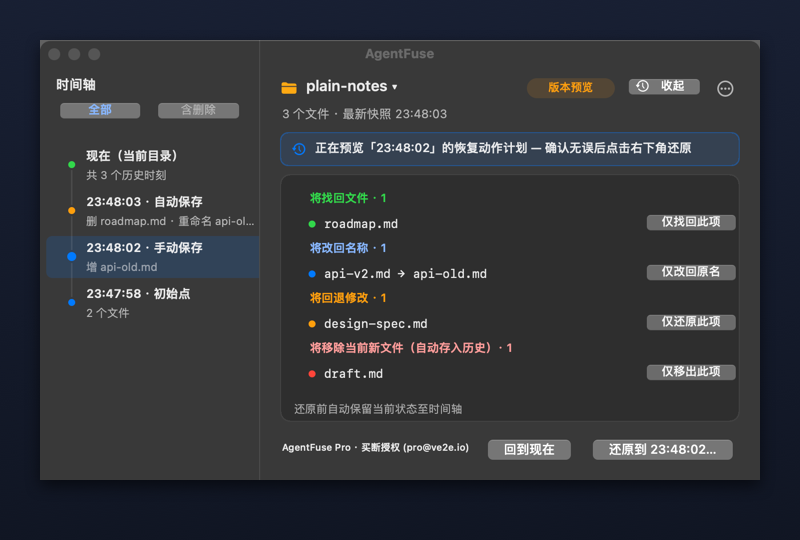

# ⚡️ `agent-fuse` (`afuse`) v0.6.2

**[English](./README.md)** | **简体中文** · **[官网](https://agentfuse.topkyo.dev/)** · **[参与贡献](./CONTRIBUTING.md)** · **[安全策略](./SECURITY.md)**

**面向 AI 编程 Agent 的 macOS APFS 写时复制毫秒时光机、可选挂载钩子与失控进程组熔断器。**





> 自主编程 Agent（`Claude Code`、`Cursor`、`Codex`、`Aider`）会频繁改写未提交文件，并在子 Shell 中执行 `rm -rf`。`git checkout` 无法找回未追踪文件。**`afuse` 调用 macOS APFS 内核 `clonefile(2)` 对脏工作区拍摄快照（`t=0` 时刻新增数据块为 `0 Bytes`），实时冻结并完整收割失控进程组及后台孙进程，在保留当前终端根目录 `cwd` Inode 不变的前提下，于数毫秒内原位还原整仓或指定单文件。**

```text
$ afuse guard --max-delete 5 --auto-rollback -- sh -c 'rm -rf src/*'
⚡️ FUSE TRIPPED (deleted_entries >= max_delete=5)
   ├─ Process group frozen & reaped (SIGSTOP -> SIGKILL -pgid)
   ├─ Dirty workspace restored in 12.60 ms (142 files · 0 B CoW at t=0)
   └─ Root Inode PRESERVED | Merkle SHA-256 Recovery Receipt VERIFIED
```

---

## 10 秒快速安装（支持 macOS 12+ APFS · `arm64` 与 `x86_64`）

```bash
# 方式 A（100% MIT 开源 CLI：源码编译或下载双架构静态二进制包）：
cargo install --git https://github.com/topkyo/agent-fuse.git
# 或在本地工作区直接离线编译（零外部 Rust 依赖库，100% 离线构建）：
cargo install --path .

# 方式 B（AgentFuse Pro 原生桌面端 + 内嵌 afuse CLI：Apple 公证切换前免弹窗一键安装）：
brew install --cask --no-quarantine topkyo/tap/agent-fuse

# 若从 GitHub Releases 手动下载 .dmg 拖入 /Applications，首次启动前执行一次清理隔离属性：
xattr -cr /Applications/AgentFuse.app
```

---

## 实机体积与基准测试数据

实测硬件基准：**2015 款 MacBook Pro（`Intel Core i5-5257U`，8 GB 内存，`macOS 12.7.6` APFS）**：

| 对比维度 | `git stash -u` | Electron / IDE 内置检查点 | **`agent-fuse` (`afuse` v0.6.2)** |
| :--- | :--- | :--- | :--- |
| 未追踪文件 + 脏工作区 + `.git` 索引 | 局部覆盖且争抢 `.git` 锁 | 仅限编辑器已打开文件且漏检 Bash 删除 | **全工作区 + `.git` 0 字节截断防护 + 单文件精准恢复（外部 `.noindex` 隔离保险库）** |
| 142 文件脏仓库快照 / 恢复耗时 | `50–800 ms` | `200–2,000 ms` | **`6.46 ms` 快照 / `12.60 ms` 原位恢复（含安全前备与 SHA-256 校验）** |
| 1,000 文件 `snap --fast`（钩子模式） | 不支持 | 不支持 | **`26.90 ms`（含完整流式 SHA-256 树哈希为 `30.22 ms`）** |
| 快照瞬间磁盘增量（`t=0`） | 压缩拷贝对象 | 重复文件副本 | **`0 Bytes` 写时复制（`clonefile(2)`）+ 自动配额回收（默认上限 `50`）** |
| 保持活跃终端 `cwd` 根目录 Inode | 是 | 是 | **是（`renamex_np` 原子目录项交换，无需重进目录）** |
| 物理阻断失控子进程与后台孙进程 | 否 | 否 | **`SIGSTOP` -> `SIGKILL -pgid` 完整进程组收割并自动回滚** |
| 二进制 / 安装包体积与峰值内存 | 不适用 | `500 MB+` Electron | **`< 900 KiB` 裁剪后 CLI（千文件峰值 RSS `1.67 MiB` · 64 MiB 流式哈希 `1.29 MiB`）· `< 5 MiB` 双架构 DMG（单架构 `~2.5 MiB`）** |

---

## 30 秒 CLI 上手指南（100% MIT 开源）

```bash
# 1. 创建 APFS 写时复制快照（--fast 跳过字节哈希读取；--if-changed 在无改动时自动去重）
afuse snap -m "before-refactor"

# 2. 对比任意快照，精确列出 +新增 / ~修改 / -删除 / 重命名的文件清单
afuse diff latest

# 3. 原位恢复整个工作区，或仅精准恢复指定单文件/相对路径（保留根目录 cwd Inode）
afuse restore latest
afuse restore latest -- src/auth.rs Cargo.toml

# 4. 为任意自主 Agent 套上文件误删、磁盘暴涨与 .git 0 字节截断防护熔断器
afuse guard --max-delete 15 --max-write-mb 256 --auto-rollback -- claude "重构鉴权模块"

# 5. 清除恢复后残留的同 Inode 废纸篓副本（无完全磁盘访问权限时自动退休已清空的 ENOENT/ESTALE 项）
afuse purge-trash --json

# 6. 输出可选挂载的 Zsh / Claude Code PreToolUse 钩子代码（自动回退探测 ~/.local/bin 与 .app 内嵌路径，免配 PATH）
afuse hook zsh                # 覆盖 claude|cursor-agent|codex|aider|gemini|opencode|goose
afuse hook claude
afuse hook uninstall          # 默认只读扫描预览（传入 --apply 自动备份 .afuse-bak-<ts> 后移除 Zsh 块）

# 7. 隐私脱敏体检与按需手动 SHA-256 校验自更新（零后台静默联网轮询）
afuse doctor [--json] [<DIR>] # 检查 APFS 卷、clonefile(2) 与保险库权限（输出不含用户名与绝对路径）
afuse upgrade --check         # 仅在手动执行时查询 GitHub Releases 新版本；去掉 --check 执行原子替换升级
```

自动创建的 `auto:*` 快照默认受环境变量 `AFUSE_MAX_AUTO_SNAPS`（默认 `50`，高频 `auto:hook:*` 钩子快照独立按 `20` 份环形回收，`auto:pre-restore` 恢复前安全备份按最近 `10` 份滚动保留，设为 `0` 可关闭主自动配额回收）保护，手动里程碑快照永久保留。所有子命令均支持 `--json` 确定性机器输出，配套 [`SKILL.md`](./SKILL.md) 供各类 AI 编程 Agent 在执行高危动作前自主调用。

---

<a id="agentfuse-pro"></a>
## **AgentFuse Pro** 原生菜单栏与毛玻璃主控桌面端（`$19` USD 约 `¥138` 一次买断）

需要零配置成本的原生 macOS 桌面级守护壳（纯手写 AppKit + QuartzCore + CoreGraphics Swift，单模块严格 `< 400` 行，主壳 `< 1.2 MiB`，双架构 DMG `< 5 MiB` / 单架构 `~2.5 MiB`，冷启动 `< 90 ms`，双仓静默守护 2 秒窗口 CPU 占用 `< 5 ms`）？

- **原生菜单栏与 `500×410` ⇄ `720×440` 图形化时间轴抽屉（`⌘Y`）**：支持拖入无 `.git` 普通文件夹或单文件，按 `⌘Y`（或点击「时间轴」）平滑展开 `720×440` 图形化垂直时间轨 + `RestorePlan` 动作导向恢复双栏，支持单文件行内 `[还原]` / `[移除]`；「帮助与诊断」内含 **5 秒安全演练** 与 **简体中文 / English** 实时切换。
- **后台零干扰守护与废纸篓 TCC 自动收敛**：支持不限目标数量并发守护（底层内置 `200` 项单机流畅护栏，含桌面、文稿、下载目录子项），单文件同级互不干扰、移动/重命名自动跟随，窗口一级菜单直达「登录时打开」，同 Inode 废纸篓副本自动清零并在未授完全磁盘访问权限时自动退休已手动清空的 `ENOENT`/`ESTALE` 条目（同步提供一键「忽略废纸篓提醒」出口）。
- **隐私脱敏「APFS 原位恢复凭证」（`1200×630` PNG）与离线反馈分流**：恢复瞬间展示耗时与 Merkle 校验状态，不自动改写系统剪贴板，提供一键**复制凭证图**、分享至 `𝕏` / `微信` 及导出 PNG；内置离线「反馈问题与支持…」双通道弹窗，技术问题一键复制脱敏 `afuse doctor` 摘要前往 GitHub Issues，订单与 14 天退款直连 `support@topkyo.dev`（严禁公开粘贴授权码）。
- **签名校验更新与终身买断授权**：免费版永久守护 `1` 个目标；Pro 版（`$19` USD 约 `¥138` 一次买断，Creem.io 全球托管，支持支付宝 / 国际卡 / Apple Pay / Google Pay / 企业报销发票；英文结账页填邮箱付款后 1 分钟内由 `license@topkyo.dev` 自动发码，未收到请查垃圾箱）离线解锁不限目标数量并发守护（`200` 项单机护栏）与最多 `3` 台本人 Mac，支持 SHA-256 与签名校验的按需更新与 14 天退款保障。访问 [官方主页 agentfuse.topkyo.dev](https://agentfuse.topkyo.dev/) 或 [下载通用 DMG](https://github.com/topkyo/agent-fuse/releases/latest)；订单、发码与退款请私密邮件联系 `support@topkyo.dev`。

---

## 安全架构、双轨签名与免责声明

- **纯本地架构与零遥测铁律**：所有快照仅存于同卷外部隔离保险库（`~/.agent-fuse/vault.noindex/<name>-<hash>`，权限 `0700`，排除 Spotlight 索引，内置自吞噬防御以及 `/`、`$HOME`、系统路径与桌面/文稿/下载顶级容器和符号链接拦截；允许守护其内部的具体子目录或单文件）。启动与后台运行期间发起 `0` 次网络请求；`afuse upgrade` 仅在用户手动触发时连接 GitHub Releases，并强制校验压缩包 SHA-256 摘要后执行原子替换。详见 [`SECURITY.md`](./SECURITY.md)。
- **macOS Gatekeeper 安装说明**：在切换至 Apple Developer ID 公证证书前，推荐使用 `brew install --cask --no-quarantine topkyo/tap/agent-fuse` 免拦截一键安装；若手动下载 `.dmg` 拖入 `/Applications`，首次运行前请执行一次 `xattr -cr /Applications/AgentFuse.app`。
- **免责声明**：`agent-fuse` 是本地 APFS 工作区辅助恢复工具，按“原样（AS IS）”提供，不附带任何明示或暗示担保。核心代码资产请务必保持异地 Git 远端备份。

## 参与贡献与开源协议

- 欢迎提交 Issue 与 PR！贡献前请阅读 [`CONTRIBUTING.md`](./CONTRIBUTING.md) 了解零外部依赖架构规范与测试门禁。
- `afuse` CLI 内核（`src/`）、挂载钩子、[`SKILL.md`](./SKILL.md) 与 [`llms.txt`](./llms.txt)：**MIT 开源协议**（[LICENSE](./LICENSE)）
- `AgentFuse.app` 原生菜单栏与主控窗口桌面端：**商业专有授权协议（Proprietary Commercial EULA）**

---

## 常见问题解答

1. **Claude Code 的 `/rewind` 或 `git checkout` 无法找回被 `rm -rf` 删掉的文件，`afuse` 能救回吗？**
   只要误删前拍摄过快照（手动执行、挂载 `afuse hook claude` 或开启桌面端 `FSEvents` 守护），即可完整救回，且支持无 `.git` 的普通文件夹与单个关键文件。Claude Code `/rewind` 不追踪 Shell `Bash` 命令造成的文件删除；`afuse` 通过 APFS `clonefile(2)` 克隆目标，可在 `~12.6 ms` 内还原 142 个文件、自动按 `(fsid, ino)` 清除 `~/.Trash` 废纸篓同名副本，或通过 `afuse restore latest -- <路径>` 精准恢复指定文件。
2. **`afuse` 与 `Provenrail`（`$9/月`）或 `git stash -u` 有何本质区别？**
   `git stash -u` 依赖 Git 仓库且争抢 `.git/index` 锁；`Provenrail` 向影子 Git 仓库复制文件且按月收费（`$108/年`）。`afuse` 直接调用内核 `clonefile(2)` 对 Git 仓库、普通目录或单文件实现零 Git 开销守护，配备独立进程组熔断器（`SIGSTOP` -> `SIGKILL -pgid`，覆盖后台孙进程与 `.git` 0 字节截断防护），提供 `$0` MIT CLI 与 `$19`（约 `¥138`）一次买断的原生桌面端。
3. **为什么 `afuse restore` 恢复后当前终端不需要重新 `cd .. && cd -`？**
   `afuse restore` 先在工作区同卷旁路克隆目标条目，再调用 Darwin 内核 `renamex_np(..., RENAME_SWAP)` 原子交换顶层目录项，始终保留工作区根目录本身的 Inode 不变，因此终端会话与语言服务器（LSP）不会悬空失效。
4. **手动拖拽 `.dmg` 安装为什么会提示“无法验证开发者”？**
   早期版本在启用 Apple Developer ID 公证前采用本地 Ad-hoc 签名。使用 `brew install --cask --no-quarantine topkyo/tap/agent-fuse` 可直接免弹窗安装，或在拖入 `/Applications` 后执行一次 `xattr -cr /Applications/AgentFuse.app`。
5. **`afuse` 会在后台偷偷联网检查更新吗？自动快照会把硬盘塞满吗？**
   均不会。启动与守护全程 `0` 网络请求，仅在用户手动运行 `afuse upgrade` 或点击菜单“检查更新”时按需查询。自动快照默认受 `AFUSE_MAX_AUTO_SNAPS=50` 滚动上限管控，`auto:pre-restore` 恢复前备份按最近 `10` 份滚动保留，手动快照永久保留。
6. **社区免费版与 `$19`（约 `¥138`）的 AgentFuse Pro 终身买断版有何区别？**
   `afuse` 命令行内核采用 MIT 协议完全免费开源（`$0`）。桌面端免费版可永久守护 `1` 个活跃目标（普通目录或单文件），完整开放 `⌘Y` 图形化时间轴与单文件恢复且无试用倒计时。AgentFuse Pro（`$19` USD 约 `¥138` 一次买断，由 Creem.io 托管支持支付宝、国际卡、Apple Pay 与企业报销发票；英文结账页填邮箱付款后 1 分钟内由 `license@topkyo.dev` 自动发码，未收到请查垃圾箱）解锁不限目标数量并发守护（底层内置 `200` 项单机流畅护栏），支持至多 `3` 台本人 Mac，采用 100% 离线 `Ed25519` 授权验证。订单、补发或 14 天退款请私密邮件联系 `support@topkyo.dev`。可访问 [官方主页](https://agentfuse.topkyo.dev/)、[GitHub Releases](https://github.com/topkyo/agent-fuse/releases/latest) 或阅读 [`llms.txt`](./llms.txt)。
